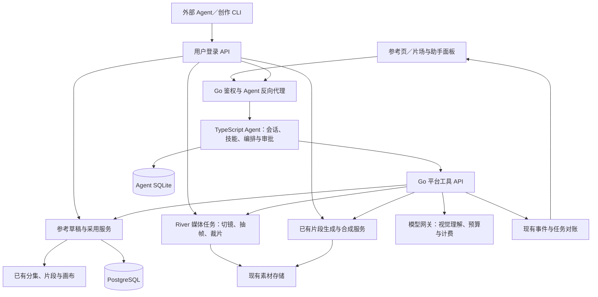

# Agent 驱动仿拍方案

## 摘要

让创作者上传原片、说明改动意图后，由站内 Agent 完成逐镜理解、参考素材准备和提示词编写，结果直接进入现有参考校订页和片场。创作者主要负责核对、选择生成方案、采用版本与成片。

目标用户是希望在网页内完成商品短片或短剧仿拍的创作者。首个闭环使用一条四镜商品样片，验收范围为分析全片、采用到片场、生成第三镜、单镜重拍和精确合成。先在现有参考剧集入口实现，再将相同分析能力接到营销工作室，随后验证两集角色与对白连续性。

技术上复用 React 工作台、独立 TypeScript Agent 服务、Go 平台 API、PostgreSQL、River、素材服务及 FFmpeg。Agent 负责理解与编排，Go 负责业务校验、素材处理、数据写入和计费。通过已有技能库提供创作方法，通过受控平台工具执行实际操作。

用户可选择站内 Agent 分析，或用外部 Agent 分析后通过登录 API／拟新增的创作 CLI 写入同一项目并生成。两种入口共用参考资料、草稿、修订、片段、任务与费用规则，可在任一阶段切换，网页能查看两边写入的结果。

**状态为设计稿，尚未实现。** 本文基于 `v0.7.2` / `81522f52`，核对日期为 2026-11-21。已有能力以第 1 节的源码为准，本文新增的工具、字段、界面和状态均属于提案。实施顺序和验收记录放在[实施与验收](Agent仿拍实施与验收.md)，最新项目状态放在[项目交接](README.md)。

## 1. 当前能力与实际缺口

| 能力 | 当前事实 | 本次设计的处理 |
| --- | --- | --- |
| 参考导入与本地拆片 | 已支持视频、拆片包、逐集切镜和历史修订。本地分析关闭 VLM、ASR、OCR、说话人及音轨分离 | 保留离线切镜，增加逐镜视觉证据和语义分析草稿。动作、对白、身份分别记录分析范围 |
| 原镜回放、采用和制作 | 已有原片时码、角色绑定、采用到片场、单镜任务、选版、裁剪及合成 | Agent 通过同一业务服务使用这些能力 |
| Agent 运行时 | 独立服务已有会话、运行、审批、事件、恢复、模型代理与预算 | 扩展业务工具及工作区上下文，沿用现有运行机制 |
| 短剧 Agent 工具 | 已有 `drama_read`、大纲／分集／片段修改及 `drama_run_job` | 增加参考资料、分析草稿、采用与片段生成工具 |
| 短剧助手界面 | `AssistantPane` 与 `SidePanel` 已存在，当前工作台未挂载助手 | 在参考页和片场提供可收起的助手入口，复用现有面板、审批卡和事件流 |
| 视觉工具 | 已有看图、看视频和截帧。视频理解当前要求 Gemini 接口格式，抽帧路径可交给支持看图的模型 | 复用底层媒体处理与计费，增加按参考集和镜头读取证据的业务入口 |
| 技能库 | 已有检索、读取和包导入。包内脚本可阅读，当前不能执行 | 方法与模板通过技能装载，切镜、抽帧等脚本能力由 Go 的已登记工具提供 |
| 生成模型能力 | `Capabilities` 保存生成方式、参考素材数量和参数，后台配置是实际校验来源 | 按实时能力选路线，冻结计划时的配置摘要，执行前复核 |

源码依据见[本地分析器](../../backend/internal/reference/analyzer.go)、[参考业务服务](../../backend/internal/service/drama_reference.go)、[工具注册表](../../backend/internal/service/agent/tool_registry.go)、[视频工具](../../backend/internal/service/agent/video.go)、[视频理解](../../backend/internal/service/agent/video_understanding.go)、[技能包预检](../../backend/internal/agent/skillpkg/finish.go)、[工作台入口](../../web/src/pages/drama/workspace/index.tsx)、[助手面板](../../web/src/pages/drama/assistant/assistant-pane.tsx)及[模型能力](../../backend/internal/provider/modelcfg/capabilities.go)。

此前已经通过制作流程的接口、媒体和页面验证。线上原镜生成测试先遇到 Agnes 视频引用格式问题，该问题已在 v0.7.2 修复，随后渠道返回额度不足。到本次设计基线为止，这条样片尚未取得真实视频生成结果，自动语义拆解与真实仿拍质量也尚未完成验收。

## 2. 产品取舍与参考项目

保留已有制作工作台，将 Agent 的结果落到可编辑数据中。用户在同一项目内对照原片、修正分镜、重做指定镜头和选择版本，Agent 可读取这些修改继续工作。

| 参考项目 | 适合吸收的部分 | 接入边界 |
| --- | --- | --- |
| rea-video | 切镜、抽帧、制作方式证据及按模型能力选择复刻路线 | 继续固定工具版本。语义分析由平台模型和技能完成，生成结果进入现有任务系统 |
| rea-toon | 短剧角色、对白、节拍、跨集阅读的方法 | 作为流程研究参考。复用源码或分发技能前核对其非商业许可和授权，当前方案可基于自有实现推进 |
| video-prompt-reverse-engineer | 逐镜反推与目标模型提示词写法 | 经来源、许可与格式核对后适配为站内技能，输出结构化草稿 |
| short-drama-hit-breakdown、Emma 编剧技能 | 剧情分析、改编、对白和剧本修订方法 | 按用户意图选择相关技能，将长篇分析按需展开 |
| seedance-storyboard-generator-realman | 分镜组织、角色一致性与成片方法 | 适配提示词方法。其即梦 CLI 登录和生成路径需要改接本平台模型渠道 |
| VIDEO.md | 拆解结果交换与分层读取 | 继续作为导入／导出格式，内部采用现有素材 ID、镜头 ID 和修订号 |
| capsule-cinema | 参考依据和镜头规划的组织方式 | 参考其数据结构与已核对的可复用模块，任务、计费和选版由当前制作服务承接 |

参考源见[原始项目清单](初步需求.md)、[既有调研](短视频仿拍二开准备.md)、[rea-video 生成策略](https://github.com/JuneYaooo/rea-video/blob/main/rea_video/generation.py)和[VIDEO.md 集成说明](https://github.com/videomd/videomd/blob/main/docs/integrate.md)。实施时记录实际采用的仓库提交、许可和本地适配版本，文档研究记录不代表已经安装全部技能。

## 3. 用户流程与首期范围

### 3.1 从上传到制作

1. 创作者上传原片，选择目标项目，并描述保留的动作／镜序、替换的商品／角色和预期画幅。现有项目直接选参考集，附件和目标镜范围成为会话的明确上下文。
2. 平台检查原片能否读取、分析模型能否看图／视频、生成模型可用能力和费用配置。Agent 展示本次处理范围及分析预算。
3. 媒体任务提取切点、每镜起止时间和有时间码的关键帧。Agent 按镜查看证据，写动作、场景、运镜、角色与提示词草稿。听到的内容、字幕文字、推测分别注明来源。
4. 草稿实时保存，参考页展示“待核对的动作／角色／对白”。用户可直接改某个字段，或对 Agent 说“第二镜动作改成……”。无证据的字段保留未知状态。
5. Agent 根据目标模型给出生成计划，列出每镜采用的参考方式、实际申请秒数、成片保留区间和预估积分。用户查看并采用一份批量修改方案，已有人工修改按差异处理。
6. 草稿通过现有采用规则写入片场，生成走片段服务。任务完成后用户对比原镜与结果，选版、只重做某镜，再用现有合成服务产出成片。

默认完成分析和方案后展示一次采用卡，准备执行付费图片／视频生成时使用现有生成审批。用户已有的同范围授权可复用，重传沿用同一批准结果。修改模型、输入、镜头范围或增加费用时，展示变更后的计划并按当前产品契约更新授权。源码现有审批行为见[短剧审批](../../backend/internal/service/agent/drama_approval.go)与[平台审批入口](../../backend/internal/service/agent/platform_approval.go)。

### 3.2 用户故事与优先级

| 编号 | 用户目标 | 可观察结果 | 优先级 |
| --- | --- | --- | --- |
| US-01 | 上传原片后得到可用的逐镜草稿 | 每镜都有证据、动作说明和可编辑提示词，正常样片无需手工粘贴整段提示词 | P0 |
| US-02 | 在预算内选择可用模型 | 根据所选渠道能力给出视频／图片／首尾帧路线，展示站内积分及费用未知项 | P0 |
| US-03 | 直接采用草稿并生成第三镜 | 片场中出现真实片段和生成任务，选版、刷新、合成均使用同一份数据 | P0 |
| US-04 | 中断后继续或只修改一镜 | 已完成的证据和草稿可恢复，已批准的同一生成不会重复提交 | P0 |
| US-05 | 修改已写好的片段时保住人工内容 | 展示明确差异，修订冲突可选择保留、合并或重新分析该镜 | P0 |
| US-06 | 两集使用同一人物与声音 | 可核对跨集身份、说话人和配音来源，修正一集不覆盖另一集 | P1 |
| US-07 | 根据参考短剧做原创改编 | 结构分析经编剧技能产生新稿，沿用已有原创写稿与片场流程 | P2 |
| US-08 | 自由选择站内或外部 Agent | 外部分析结果可写入同一草稿，网页编辑后外部 Agent 可读取最新修订继续生成 | P0 |

首期采用四镜、十秒商品样片作为最小验收对象，另选不同画面结构的短片复测。首期支持视觉理解、提示词、参考图准备和单镜制作。对白的完整 ASR／OCR、说话人及跨集归并在 P1 验收。听觉链路未完成时，界面必须能区分“未分析音频”“未检测到音轨”和“听不清”。

### 3.3 站内与外部 Agent 共用项目

| 使用方式 | 分析由谁完成 | 后续制作与同步 |
| --- | --- | --- |
| 网页内使用助手 | 站内 Agent 使用平台配置的分析模型与技能 | 草稿和计划进入参考页与片场，用户在网页生成、选版和合成 |
| 外部 Agent 操作平台 | 外部 Agent 在其运行环境分析原片，也可调用平台媒体准备接口取得证据 | 通过登录 API／CLI 保存草稿、采用并提交平台生成，结果自动进入同一项目 |
| 外部客户端调用站内助手 | 外部客户端通过已有 Agent 会话 API 发起运行 | 分析模型、预算、审批和运行记录仍由站内 Agent 管理，外部客户端和网页均可查看进度 |

切换时以业务数据为交接依据。外部 Agent 将分析结论、证据映射和用户意图写入草稿，站内 Agent 读取最新草稿接续；外部 Agent 同样读取网页编辑后的修订继续工作。两端聊天全文各自保留，共用的是项目结果和结构化意图。

外部分析使用的平台外模型，其费用和执行记录由外部环境负责。调用平台生成、平台模型分析或平台图片准备时，继续按平台计费。CLI 展示站内报价和需要由外部环境承担的项目，缺少外部费用数据时标为未知。

外部已经生成的成片可通过现有素材上传 API 入库。将这类素材挂成某镜的正式采用版本还需单独设计导入结果接口，当前片场采用的是已成功生成任务，因此完整的外部成片逐镜回填列入后续 B3。首期外部 Agent 通过平台生成即可共用既有选版与合成流程。

## 4. 架构与数据归属

| 层 | 职责与数据归属 | 主要改动位置 |
| --- | --- | --- |
| React | 发起意图、范围选择、草稿对照、审批和结果编辑 | `web/src/pages/drama/references/`、`workspace/`、`assistant/`、`studio/` |
| Agent | 保存会话与阶段检查点，选择技能，按证据生成结构化草稿，等待平台任务 | `agent/src/durable-tools.ts`、`platform-client.ts`、已有运行／审批处理 |
| Go Agent bridge | 工具声明、项目归属校验、审批提案及业务服务调用 | `backend/internal/service/agent/`、`tool_decls.json`、`internal/handler/agent/` |
| Go 业务服务 | 参考修订、草稿、计划、采用事务、生成幂等与费用校验 | `backend/internal/service/drama_reference*`、`drama_segment*` 和新增草稿服务 |
| 媒体工具 | 固定命令切镜与指定帧／区间处理，派生媒体缓存及取消 | `backend/internal/reference/`、`internal/pkg/videoframe/`、River worker |
| 技能 | 视觉观察、提示词写法、改编方法，明确输入证据与输出字段 | 现有技能库，必要时新增内置中文技能 |

沿用现有 `/internal/platform/v1` 和服务令牌。用户、画布、会话、运行标识由可信运行上下文提供。参考集和目标片段必须属于上下文中的同一项目，资产必须通过现有归属检查。模型渠道密钥继续由 Go 管理。

外部客户端使用 `/api/v1` 用户登录 API，身份由用户凭据确定。内部 `/internal/platform/v1` 信任站内 Agent 的运行上下文，只供服务间调用。外部 API 与内部工具在服务层汇合，外部客户端无需服务器 Shell、数据库账号或内部服务令牌。

Agent SQLite 保存编排进度，PostgreSQL 保存可编辑业务草稿与媒体任务结果。消息中的长文本和临时链接只作展示，恢复时按业务 ID 重读。Agent 重启后先查询平台任务和草稿版本，再决定下一步。

## 5. 逐镜理解与生成路线

### 5.1 证据准备和语义分析

媒体准备按原素材和参考修订创建独立任务。已有可用切点可直接复用，每镜选起始、动作中段和结束附近的帧，采样点必须落在该镜左闭右开的实际时间区间内。极短镜头去掉重复采样点，动作不明确时由 Agent 请求补帧或查看该段视频。

逐镜帧与可复用参考图由素材服务保存，记录原素材 ID、原片时间、处理参数和处理版本。Agent 的看图调用沿用已有单次图片数量限制。会话只保留证据 ID 与观察结论，图片按需重载。当前分析器会清理整个临时目录，因此持久保存证据属于新增实现，不能依赖该目录在下次调用仍然存在。

视觉模型的输入包括镜号、时间码、按序帧图、用户要求和必要的前镜摘要。输出包括可观察动作、构图／运镜、场景、角色候选、待确认项和证据引用。技能约束输出，Go 校验 schema、时间范围、引用和字段大小。仅有单帧证据时不得把运动方向写成已确认事实。

原生视频理解可复用当前 Gemini 路径，必须记录实际是否取得音频分析结果。其他视觉模型走逐镜抽帧。字幕 OCR、语音 ASR 和说话人分析在 P1 加入，字幕文本不得直接当成确定说话人。

### 5.2 按能力规划

| 模型与素材条件 | 生成计划 | 验收重点 |
| --- | --- | --- |
| 支持视频参考，用户要求保留动作与节奏 | 每镜使用已裁出的原镜片段，可叠加允许的目标角色／商品图 | 视频长度、大小、静音规则与图片／音频组合均合法 |
| 支持首帧或首尾帧 | 从原镜选帧，换商品／角色时先生成目标关键帧，再以运动提示词生成 | 关键帧确实作为首／尾帧发送，参考模式互斥规则正确 |
| 支持多图参考 | 使用角色、商品和构图图，按镜编写动作提示词 | 参考图上限、排序及角色一致性，避免错误占用首帧位置 |
| 仅支持文字 | 展示一致性风险较高的文字方案，用户可选其他模型 | 提示词独立可读，界面说明参考素材未传给模型 |
| 能力配置与供应商协议冲突 | 将该路线标为不可执行，并指出配置需要修正的字段 | 在付费提交前阻止已知不支持的参数 |

能力来自模型 `Capabilities` 与已适配协议，提示词格式来自 `prompt_format`。当前通用能力结构没有明确表达全部首尾帧／参考模式互斥、视频最小输入时长等限制，首期应以向后兼容的可选约束扩展和协议校验补齐。历史模型缺少这些约束时标为未核验，使用已有合法方式，不能仅凭模型名字推断支持情况。

自动方案选择参考[rea-video 的生成路线](https://github.com/JuneYaooo/rea-video/blob/main/rea_video/generation.py)，可执行判断以本平台实际渠道为准。Agnes 普通版支持视频参考，Flash 当前文档规定不接收视频，这可作为两条路线的回归夹具。限时免费资格与第三方渠道收费需要分别核实，平台不根据 `flash` 名字认定免费。

每个目标片段独立记录原镜区间、申请生成时长和采用裁剪区间。先保证单镜重做语义，再考虑合并快切镜头。合并生成属于 P2，届时必须显示一次重做影响哪些镜头。P0 中图片准备完成后重新读取实际素材、重算视频报价，再提交视频生成。

分析费、目标关键帧图片费、视频生成费分别预估和记录。页面上的站内积分沿用现有计价，渠道余额无法查询时显示未知。遇到渠道额度不足停止该阶段并保留草稿，不自动循环重发付费请求。

## 6. 草稿、证据与修订

新增对象的名称与字段在实现时落为模型和迁移。设计采用以下最小集合，迁移编号在开发时按仓库最新编号分配。

| 对象 | 关键内容 | 用途 |
| --- | --- | --- |
| `ReferencePreparation` | 用户／项目／参考集、原素材、基准修订、处理版本、请求键、任务状态、证据素材清单、错误 | River 媒体准备的持久结果，多个 Agent 步骤可复用 |
| `ReferenceDraft` | 用户／项目／参考集、基准修订、准备任务 ID、会话／运行来源、草稿修订、分析文档、字段证据、生成计划、模型配置摘要、技能版本 | 保存语义结果和制作提案，刷新与续跑时可读取 |
| `ReferenceDraftApplication` | 用户、草稿 ID／修订、操作类型、请求键、内容摘要、审批 ID、结果修订及采用记录／片段 ID | 采用幂等回执，与正式业务写入同事务提交 |

草稿状态建议为 `editing`、`ready`、`applied`、`discarded`。修订冲突作为操作结果返回，草稿可继续编辑。媒体准备任务使用 `queued`、`running`、`succeeded`、`failed`、`canceled`，独立于参考集当前已采用文档。

`ReferenceDraft.document` 复用 `DramaReferenceDocument`，新增证据与待确认信息放在草稿的附加字段中。现有 `ready` 只表示拆片处理成功，新增 `coverage` 区分镜头边界、视觉语义、对白、说话人的完成状态。旧数据的覆盖情况由实际字段和处理方法推导，未知项标为未知。

草稿来源记录为站内 Agent、外部客户端或人工编辑。外部草稿的站内会话／运行 ID 可为空，用户身份和审计来源由登录接口确定，客户端不能伪造站内运行归属。外部证据文件先上传为本人素材，再通过时间码关联原镜。

字段来源至少包括 `source`（模型观察／导入／人工）、`evidence_ids`、`review_state`（观察到／推断／未知／人工确认）。未校准的模型分数不得当成识别准确率。人物和商品的“原片中是什么”与“本次要换成什么”分别保存，原片观察不被创作意图覆盖。

生成计划单元保存 `shot_ids`、目标片段、生成方式、参考素材 ID、目标角色节点及修订、有效提示词、申请秒数、目标裁剪、模型 key、配置摘要和报价。模型配置当前无版本历史，采用摘要检测计划生成后发生的配置变化，实际提交仍由现有任务快照固定参数。

用户编辑先持久保存草稿。继续分析时只写仍符合基准版本的目标字段，人工修改通过差异合并处理。采用时锁定并检查参考、目标分集、片段和角色修订，一次批量采用整体成功或返回冲突。采用完成后原稿、角色映射和目标生成提示词保持可追溯关系。

新草稿采用时在同一事务更新参考文档／绑定、创建或更新分集与片段、登记采用回执。保留既有“同一参考修订的默认重复采用返回旧记录”的契约。对已采用镜头修改目标提示词时，必须携带目标片段修订并走批量更新，不能把重复采用结果误当成已应用新提示词。

实现该事务时，将现有参考保存和采用中的校验／写入逻辑提取为服务内部可复用步骤，由同一 repository 事务接口承接。Agent bridge 只调用业务服务，不逐次调用多个 HTTP 写接口来模拟原子采用。媒体证据按用户、原素材、区间、处理参数和处理版本去重，运行中的任务与已采用草稿引用的素材不得被临时文件清理删除。

## 7. Agent 工具与接口提案

以下工具尚未注册。参数沿用领域接口的 snake_case，实际 ID 编码与当前接口保持一致。所有写入经服务层校验。返回的大结果按参考集／镜号分页，媒体通过素材 ID 引用。

| 工具 | 参数重点 | 结果与副作用 |
| --- | --- | --- |
| `drama_reference_read` | `reference_id`、可选修订、镜号范围／游标 | 读取当前或历史文档、角色绑定、证据和草稿摘要 |
| `drama_reference_prepare` | `reference_id`、`revision`、`shot_ids`、`request_key` | 创建或复用媒体准备任务，返回准备 ID 和状态；原稿保持可编辑 |
| `drama_reference_status` | `preparation_id` 或 `draft_id` | 查询准备结果／草稿版本，供恢复和等待任务使用 |
| `drama_reference_inspect` | `preparation_id`、`shot_ids`、可选补充时间点 | 返回选定镜头的图片、时间码与已保存的音频分析证据；原生视频调用计入运行预算 |
| `drama_reference_draft` | 草稿 ID／修订、观察结果、证据引用、目标提示词与素材选择 | 创建／更新草稿并由 Go 编译、校验生成计划，返回覆盖状态、问题列表与报价 |
| `drama_reference_apply` | 草稿 ID／修订、目标集、目标修订、镜头范围、请求键 | 创建批量修改审批，执行时调用参考／采用服务并登记幂等回执 |
| `drama_generate_segments` | 计划 ID／修订、片段范围和各自修订 | 生成审批与提交，复用 `DramaSegmentService.Generate`、参考裁片和生成意图 |

继续复用 `model_list`、`skill_search`、`skill_read`、`drama_read`、`task_get` 和 `drama_run_job`（合成）。图片准备使用现有 `generate_media`，素材与目标关键帧绑定完成后再准备片段生成。工具执行方声明、模式限制、平台审批映射、Agent durable 工具分类及前端卡片须一起更新。

`canvas_inspect_video` 当前只接收画布视频节点，`canvas_capture_frame` 会创建画布节点。新的参考证据入口复用它们的媒体能力，以参考集归属为入口保存证据，避免为每张观察帧创建创作节点。需要作为生成参考的帧才进入对应的正式参考素材关联。

`generate_media` 当前针对画布节点，直接用它生成片段会绕过参考片段的生成意图和裁剪约束。新的片段生成工具必须复用片段服务。前端手动生成也读取同一份有效计划，当前 `segment-input.ts` 的素材组装规则应与服务器计划编译对齐，并有前后端契约测试。

拟新增的登录 API 用于网页查询／编辑草稿，与工具复用相同服务。

| API 提案 | 用途 |
| --- | --- |
| `GET /dramas/:id/references/:reference/drafts` | 草稿列表 |
| `POST /dramas/:id/references/:reference/drafts` | 创建外部或网页草稿，带基准修订、结构化文档、证据映射及请求键 |
| `GET /dramas/:id/references/:reference/drafts/:draft` | 单份草稿、证据与计划 |
| `PATCH /dramas/:id/references/:reference/drafts/:draft` | 带草稿修订修改指定字段 |
| `POST /dramas/:id/references/:reference/drafts/:draft/quote` | 校验目标模型、素材和申请时长，返回同一计划编译器的报价及问题列表 |
| `POST /dramas/:id/references/:reference/drafts/:draft/apply` | 用户在网页直接采用，带范围、修订及请求键 |
| `POST /dramas/:id/references/:reference/preparations` | 创建或复用媒体准备任务，外部客户端可取得与站内 Agent 相同的证据 |
| `GET /dramas/:id/references/:reference/preparations/:preparation` | 媒体任务状态和证据清单 |

网页通过既有 Agent 会话 API 发起分析，业务 API 处理草稿。正式接口路径、错误码及响应结构在实施前补充到[参考导入契约](参考剧集导入.md)，新增项须标注所属版本。旧 `/analyze` 继续代表已有离线分析行为，新增媒体准备以独立 ID 运行。

### 7.1 创作 CLI 提案

截至 v0.7.2，项目已有服务启动／迁移命令、Agent 数据备份命令，以及读取运行记录的 `scripts/agent-trace`。内置的 `rea-video` 也提供第三方分析 CLI。当前尚无把登录、上传、草稿、生成和合成统一封装的 video-canvas 创作 CLI，也未提供对外的创作 MCP 服务。Agent 中的 MCP 依赖用于调用联网工具。[服务入口](../../backend/cmd/server/main.go) · [运行观测 CLI](../../scripts/agent-trace/README.md) · [联网客户端](../../agent/src/web-access.ts)

新增 CLI 作为用户 API 的轻量客户端，命令暂定为 `vc`，放在独立的 `cli/` 目录，运行时使用 Node 22。依赖服务端公开的业务接口和 schema，不承载模型选择、计价、采用和合成的第二套规则。外部 Agent 可以调用 CLI，也可以直接调用 HTTP。

| 命令组提案 | 主要用途 |
| --- | --- |
| `vc auth`、`vc project` | 配置站点、登录和选择项目，凭据写本地私有配置，不出现在命令参数和普通输出 |
| `vc asset upload` | 上传原片、参考图或外部产物，返回素材 ID |
| `vc reference prepare/import/get` | 准备证据、导入已有 VIDEO.md／标准拆片包、读取当前参考修订 |
| `vc draft create/get/update/quote/apply` | 写入外部分析草稿、读取最新版本、报价、采用到片场 |
| `vc segment generate`、`vc task get/wait` | 经片段服务生成、查询或有超时地等待，显示任务 ID 与进度 |
| `vc episode compose` | 按已有选版和裁剪请求合成，返回合成任务／运行 ID |

CLI 首版沿用现有用户登录 JWT。适合长期自动化的可撤销、限项目令牌属于后续鉴权扩展，现有 `agent-trace` 只读分析令牌不能用于创作。客户端不得把内部服务令牌当成用户凭据。付费提交由用户在当前操作中明确选择，外部 Agent 已取得的同范围授权可用于发起相应 API 操作；若操作委托给站内 Agent，则沿用其现有审批状态。

为外部 Agent 提供 `--json` 输出、明确退出码、可查询的操作 ID、`--request-key` 和版本参数。单次操作的请求键在客户端提交前持久保存，网络超时后先查任务再重发。外部输入中的本机路径先上传并映射成平台素材 ID。`quote`／预览只校验和报价，`generate` 是实际付费提交，两者在命令帮助中明确。

首版 CLI 随 A8 验收，最少覆盖登录、素材上传、外部草稿写入、报价、采用、单镜生成、任务等待与合成。可供 Agent 读取的使用技能随 CLI 提供，说明字段、返回值和错误处理。MCP 可在这些接口稳定后复用同一 API 客户端增加，对首期闭环无硬依赖。

## 8. 交互、恢复与异常

参考页提供“助手分析”入口和可编辑草稿。片场提供“让助手补全本镜”“重做选中镜头”等范围明确的入口。面板默认可收起，窄窗口以抽屉展示，复用现有 `AgentPanel`。上下文应展示当前项目、参考集和选中镜头，避免切换页面后 Agent 操作旧对象。

分析进度显示当前阶段和完成镜数，生成阶段继续使用现有任务状态。等待审批、无可用视觉模型、渠道额度不足、需要补充商品／角色素材都有明确的可恢复状态。切镜成功但缺少语义结果时显示“已切镜，待理解”，不显示为完整分析完成。

| 情况 | 处理行为 |
| --- | --- |
| 分析模型只有文字能力 | 允许读取已有文档，分析入口指出需要视觉模型并列出可用选项 |
| 原片无音轨或音频服务未接通 | 分别记录无音轨／未分析，用户可以继续视觉制作 |
| 个别镜头看不清 | 保存其余镜头，标记该镜待确认，允许补帧或只重试这一镜 |
| 用户在 Agent 分析中改了提示词 | 草稿写入检查修订与字段来源，保留用户编辑并返回差异 |
| 页面刷新或 Agent 重启 | 从准备 ID、草稿 ID、批准计划及任务 ID 恢复，不重新开始已完成步骤 |
| 采用响应丢失 | 相同请求键和内容摘要返回原采用回执，不重复建集和片段 |
| 生成提交响应丢失 | 先按生成意图对账，相同批准项沿用稳定幂等键 |
| 上游超时且无法确认是否受理 | 标为状态待核对，已有上游任务可查则继续查询，避免把未知结果当作可安全重发 |
| 费用、模型配置或引用素材发生变化 | 执行前重新校验，展示变化并更新计划，已批准的旧输入不得被静默替换 |
| 用户取消 | 中止尚未执行的编排和媒体准备，保留已保存草稿，已提交模型任务按现有取消／结算规则处理 |

只读工具可按现有 durable 安全重放规则恢复。草稿／采用写入通过业务请求键和修订去重，付费操作通过批准项和生成意图去重。新模型回复产生新的工具调用 ID 时，也不能改变同一业务操作的幂等键。模型观测调用存在外部超时的不确定性，不能承诺外部请求严格只执行一次，须记录已发起／结果未知并按预算处理。

## 9. 质量标准、发布与验证

每个实现步骤先写针对用户行为的失败测试，再实现并跑定向和受影响端的完整检查。既有后端测试目录、前端测试目录、格式化工具、迁移只增规则保持一致。文档检查单独执行，无代码改动时无需安装应用依赖。

首期完成标准是普通用户经正常入口从上传到真实单镜结果，全程无需手工搬运提示词。每个生成单元必须可追溯到观察证据和用户要求。对两段不同样片逐镜检查对象、动作、运镜及未知项，出现无证据补写时记为未通过，并修订技能或工具后复测。

真实模型验收必须同时验证图片参考路线与视频参考路线，记录耗时、站内积分、可取得的渠道费用和生成效果。模型替身用于重复提交、修订冲突和合成快照测试，不能替代真实画面质量验收。项目素材、请求全文和运行日志放在被忽略的 `.traces/` 中，公共文档只记录脱敏结论和证据路径。

开发期间新入口受功能开关控制。先发布媒体证据和草稿，再启用采用与生成。上线前执行版本迁移、旧项目读取和 Agent 恢复回归。回退仅关闭新入口，已完成业务数据仍按现有参考稿、分集、片段和任务读取。具体任务、依赖和验收状态见[实施与验收](Agent仿拍实施与验收.md)。

首期外部依赖包括一条可用视觉模型渠道、一条图片生成渠道，以及分别支持图片参考和视频参考的视频渠道。费用或能力未核验时，标明尚未通过对应真实验收；媒体处理和结构化草稿仍可用确定性夹具开发。主要风险是视觉误判、参考素材一致性不足、模型能力配置漂移和长运行中断，分别通过证据核对、目标关键帧、执行前能力校验和持久任务回执验证。

## 10. 文档维护

每个实现提交同步更新本目录的当前状态和对应接口／验收说明。设计稿中已实现的部分注明版本与源码，改变的决策记录原因和受影响文档。对历史发布和历史验证保留当时事实，首页展示最新结果与剩余缺口。

| 事实类型 | 维护位置 | 更新时机 |
| --- | --- | --- |
| 当前能做什么、还缺什么 | [README](README.md) | 每个阶段完成、失败阻塞或发布后 |
| 本阶段产品目标与技术决策 | 本文 | 方案确定、范围或实现取舍改变时 |
| 工具／API 参数、字段与错误 | [参考导入契约](参考剧集导入.md)、[短剧出片契约](短剧仿拍出片.md)及对应主接口文档 | 实现接口的同一提交 |
| 任务、测试与真实效果证据 | [实施与验收](Agent仿拍实施与验收.md) | 每项验证结束时 |
| 用户可感知发布变化 | 根目录 `CHANGELOG.md` | 功能／修复提交时写入 Unreleased，发布时归档 |

文档持续更新以源码、测试和实际部署为依据。“设计完成”“代码完成”“检查通过”“已部署”“真实模型验收通过”分别记录，避免用一个“完成”覆盖全部状态。
