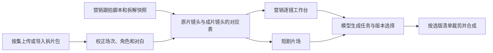

# 营销短视频与多集短剧仿拍设计

2026-11-18 初稿。实现基线为 `lookoupai/video-canvas` 的 `master@f0b8ced`（v0.6.18）。本文中的新表、接口和界面均为设计提案。产品目标是让创作者从一条参考片或多集参考剧出发，使用自己的商品、角色和素材改编，能回看依据、重做单镜、选择版本、合成成片。

2026-11-21 状态更新：本文的四项制作基础改造已落地并随 v0.7.2 部署，以下保留第一阶段设计意图。实际接口、迁移和验证结果以[交接记录](README.md)、[参考导入契约](参考剧集导入.md)和[短剧出片契约](短剧仿拍出片.md)为准。当前本地分析仅提供离线拆片，自动理解画面、对白及提示词尚待接入；真实视频生成测试被渠道额度不足阻断。下一阶段见[Agent 驱动仿拍方案](prd-Agent驱动仿拍-2026-11-21.md)。

## 两条实际使用流程

**营销。** 创作者进入营销工作室，上传参考片和自己的商品图，核对商品事实卡及已有跟拍脚本。新入口「逐镜仿拍」列出每个成片镜头及其对应原片时段。点第三镜可回看原动作，修改为新商品的动作或旁白，查看模型可用的时长和本次积分，再生成这一镜。创作者在新旧版本中选择，合成时使用选定版本。原有「整条出片」继续承接整条一次生成的需求。

**短剧。** 创作者在短剧工作室选择「从参考剧集创建」，每集关联一个视频素材，并可调整集序。拆解先给出可回看的场次、镜头和对白，用户可修正说话人，合并同一角色在不同集的称呼，替换成项目中的新角色、音色和场景。支持两种创作意图：保留原镜序重拍，或保留冲突和转折、改写剧本再分镜。采用后进入已有短剧片场，按片段生成、选版、合成单集。新故事中的原创镜头允许没有原镜对应。

## 第一阶段设计时的源码基线

本节描述 v0.6.18 的起点。表中“需要接入”的制作能力已经在第一阶段实现，最新能力边界见[交接记录](README.md#最新能力边界)。

| 代码入口 | 实现时要遵守的事实 |
| --- | --- |
| [营销模型](../../backend/internal/model/marketing.go) · [跟拍落库](../../backend/internal/service/marketing_apply.go) · [镜头对应](../../backend/internal/marketing/follow.go) | `FollowBasis` 保存跟拍时采用的拆解快照，`FollowMap` 保存完整映射。参考镜号从 1 起，目标脚本下标从 0 起。多个参考镜可合成一个目标镜，镜头上的 `RefShot` 只记录其中一个。重写跟拍可原地更新同一脚本 ID 并增加版本。 |
| [营销出片](../../backend/internal/service/marketing_render.go) · [画布构造](../../backend/internal/agent/canvasgraph/marketing.go) | 营销当前按脚本提交整条任务。发往画布会创建逐镜待生成节点，各节点连接同一完整参考视频。逐镜裁片、持久选版与营销合成需要接入。 |
| [分集剧本](../../backend/internal/drama/prompts/scripts_draft.md) · [短剧片段](../../backend/internal/model/drama_segment.go) · [生成入口](../../backend/internal/service/drama_segment_generate.go) | 分集创作已有角色表和上集结尾。片段已有稳定 ID、修订号、整数生成秒数及选中的任务 ID。片段生成要求分集已锁定并检查任务冲突。 |
| [生成事务](../../backend/internal/service/generation_task_create.go) · [短剧合成快照](../../backend/internal/service/drama_compose.go) · [FFmpeg 合成](../../backend/internal/pkg/videoframe/compose.go) | 模型任务已实现幂等、积分冻结和队列。短剧合成固定提交时采用的素材并记录跳过的片段。底层合成按输入片段的实际时长拼接，可统一尺寸、帧率和音轨。 |

## 共用的分镜和时间

产品内由 Go 服务管理素材归属、分镜修订和任务，PostgreSQL 保存项目数据，原片及派生视频进入现有素材存储。React 工作台调用 Go API，继续使用现有任务通知与重连查询。内置营销拆解可直接作为第一种输入。后续接 `rea-video` 时，由后台任务处理指定素材，输出的 `VIDEO.md` 用同一格式导入；Python 和 FFmpeg 放在能处理媒体的工作进程中，模型协议插件继续负责供应商请求转换。

| 需要保存的信息 | 设计约定 |
| --- | --- |
| 原片与拆解修订 | 每条素材记录所有者、素材 ID、实测时长和分析来源。每版原镜有稳定标识、镜序、起止毫秒、动作、运镜和可选关键帧。短剧的原镜另关联集、场和可修正的角色记录。重新分析产生新修订，正在制作的镜头继续使用已采用的修订。 |
| 成片镜头与来源 | 每个成片镜头有稳定 ID、展示顺序、目标时长和有序的原镜引用列表。来源区间用原片本地时间的左闭右开区间。目标镜时长单独存储。例如原片 5–7.5 秒的动作可改为成片里 2 秒的动作。多个不连续来源应依次裁取，不能用最早、最晚时间包成一段。 |
| 生成结果与合成 | 每次生成保存镜头修订、提示词、参考素材、模型、实际申请时长及任务 ID。每镜保存采用的成功版本。合成快照固定顺序、素材 ID 和各素材要保留的时间窗。模型返回 5 秒而成片只需 2.5 秒时，从采用素材裁出选中的 2.5 秒后再合成。 |
| 短剧的角色与对白 | 角色身份在整部剧内复用。原剧角色和新角色资产分别记录，姓名或外观相似时可人工合并与拆分。对白按原集时间记录说话人及文本，一句可跨两个镜头，一个镜头可有两个人说话。识别置信度低时允许保存待定状态。 |

**落库顺序。** 第一项只读预览从现有跟拍数据计算。开始做逐镜生成时再添加制作计划、镜头及其来源、生成版本和合成快照的增量迁移。计划关联具体营销脚本及修订，短剧导入记录关联实际短剧项目、分集和片段 ID。生成结果引用现有任务与素材；短剧选版以原有 `ChosenTaskID` 为准。营销脚本更新后可以从新修订建立新计划，已有采用版本仍可回看。历史项目首次打开时按需构造预览。

## 工作台与接口草案

路径沿用现有 `/api/v1` 登录路由与十六进制业务 ID。下表中「新增」表示待实现，具体命名可在实现时随仓库惯例调整。[现有路由](../../backend/internal/router/router.go)

| 用户操作 | 接口和行为 |
| --- | --- |
| 看逐镜对应（新增） | `GET /marketing-scripts/:id/remake-preview`。返回脚本修订、原素材 ID、各目标镜时长及全部来源区间。优先读 `FollowBasis` 和 `FollowMap`；历史数据只有 `ref_shot` 时标明映射可能不完整，无法可靠匹配时展示待关联。脚本与当前拆解有差异时标记版本，允许回看原依据。 |
| 建计划与改镜头（新增） | `POST /marketing-scripts/:id/remake-plans` 固定所见脚本修订。修改镜头编辑稿或来源时携带镜头修订号，冲突时返回最新版本供重新加载。左侧镜头列表，中间原片区间与采用视频对照，右侧编辑动作、旁白及参考素材。[营销工作台](../../web/src/pages/marketing/detail/inspector.tsx) |
| 生成、选版和合成（营销新增） | `POST /remake-shots/:id/generate`、`PATCH /remake-shots/:id`、`POST /remake-plans/:id/compose`。生成前裁好来源片段并检查所选模型对图片、参考视频数量和时长的约束。选版校验任务属于本人、本镜且已成功。整片合成前指出缺镜，若用户明确选了部分镜头，仅用本次范围。 |
| 短剧导入（新增） | 短剧向导录入集号和素材，异步分析返回每集状态，成功集可先校订。预览中按行回放原片时间段并校对角色和对白。「采用到片场」固定导入修订，建立或关联分集、剧本和片段。重复提交同一修订返回已建关联，已人工编辑的场次再次导入时可选择更新范围。 |
| 在短剧片场出片（复用） | 经现有分集编辑、锁定流程，再走 `/drama-segments/:sid/generate`、选版和分集合成。保留原片精确毫秒，模型所需整数秒单独换算。仿拍流程需要精确剪辑时在合成前生成派生素材，再复用现有合成器。[短剧片场](../../web/src/pages/drama/studio) |

**任务失败与重试。** 每次用户主动重拍产生新的生成意图。重复点击、网络重传使用同一个 `Idempotency-Key`，校验所属镜头与输入快照，再复用任务。派生裁片按原素材、区间及处理参数复用。生成任务与版本关联要能从固定镜头标识和幂等键补写，避免任务成功后页面丢失结果。裁片失败可重试准备阶段，生成失败沿用平台结算；合成重试仅重用提交时的采用清单。所有引用在服务器按用户和项目归属解析。

**模型输入。** 营销保留商品事实卡、商品图与用户旁白；短剧保留项目角色图、音色和说话人。每次生成显式记录原片声音是否作为参考，默认用目标稿对白或旁白出片。仅能看抽帧时，台词显示来源或待校订，后续可接 ASR。逐镜任务与整条脚本各有自己的提示词；整片手改稿可回看，无法可靠拆到某镜的文字交给该镜编辑器处理。第一版按单镜独立重做，后续模型需要合并生成段时，应在提交前显示受影响的全部镜号。

## 实施次序与验收

| 顺序 | 可交付结果 | 判定完成的方法 |
| --- | --- | --- |
| 1 · 只读预览 | 从现有跟拍脚本打开逐镜来源列表，点击后按原片时间段播放。首个变更从营销后端的映射测试开始，接查询接口，再接工作台。 | 用护手霜 10 秒样例配一份测试用的一对一跟拍映射，四段依次为 0–2.5、2.5–5、5–7.5、7.5–10 秒。再让镜 1、3 对应同一目标镜，验证两个独立区间都可回放；改变当前拆解后仍能看到旧脚本采用的区间。刷新可复现，全流程无需模型。 |
| 2 · 营销单镜重拍 | 增加独立裁片、逐镜任务、选版和按目标时长合成。 | 四镜中只重做第 3 镜。同一操作的重传只有一笔任务和对应冻结，失败时仍可选旧版。重排或选版后再合成，核对视频时长、镜序和声音接点。用任务替身先验证状态，再用真实模型记录耗时、积分和商品外观。 |
| 3 · 剧集拆解和校订 | 按集导入已有拆片包，随后接 `rea-video` 分集分析。增加跨集角色映射、对白校订及原片回放。 | 选相邻两集各一场，含同一角色和双人对白。用户能在第二集纠正说话人，将同一角色映射至同一新角色资产。某一集分析失败后只重试该集，另一集的人工修订保留。可先用自制两集样例开发和测映射。 |
| 4 · 短剧仿拍出片 | 支持从修订过的拆解生成跟拍稿或原创改编稿，进入已有分集片场。 | 新角色出现在两集，选择一镜重拍后重新合成指定集，另一集及其他镜头的采用版本可核对。用真实样片检查人物、声音、动作衔接，记录误判位置和生成费用。 |

外部 `VIDEO.md` 导入和跨集人物表是独立工作，可与营销出片并行推进。当前参考代码验证过分镜读取和分组。`rea-toon` 的非商业许可使商业部署需要另行授权，本设计以 `rea-video` 分集拆解和平台内角色映射作为可实施路径。融光的首尾帧编辑可用于后续改善跨镜接续。出处、许可和已跑通的样例见[二开准备](短视频仿拍二开准备.md)。
